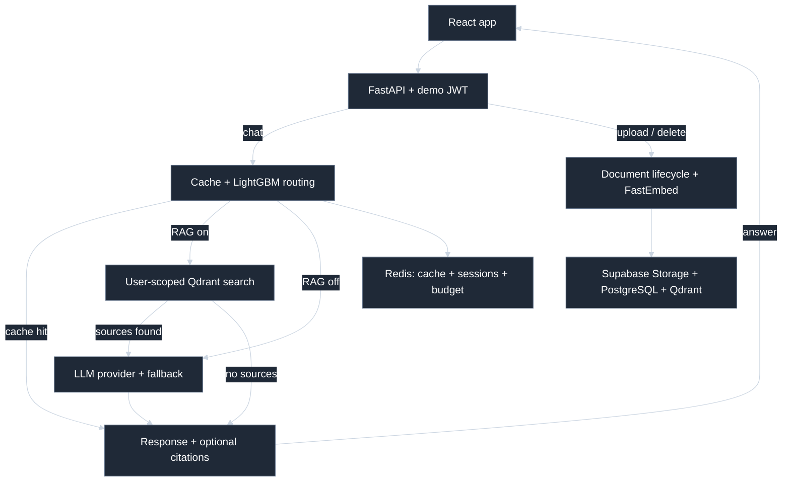

# SmartRoute-AI

**A chat application that routes requests to a configured LLM tier and can answer from a user's uploaded documents with source-linked citations.**

Live: [Click Here](https://smartroute-ai-0tur.onrender.com).


Python · FastAPI · LightGBM · FastEmbed · Qdrant · Redis · PostgreSQL · React · Docker

SmartRoute-AI addresses two practical problems: sending every question to the same model, and answering document questions without a clear link to evidence. A classifier predicts query complexity; a selected strategy maps that prediction to an economy, balanced, or quality tier at one active provider. With document retrieval enabled, the application searches only the authenticated user's active uploads and streams answers with clickable filename, page, and excerpt details.

The repository includes a Render web service and a Key Value service. The frontend and API share one origin. `/health` checks process liveness; `/ready` also checks the provider and backing services.

## Evidence

### ML classifier

| Metric | Score |
|---|---:|
| Accuracy | 96.67% |
| Macro precision | 96.97% |
| Macro recall | 96.67% |
| Macro F1 | 96.66% |

These scores come from the committed classifier metrics artifact. Its small synthetic holdout is a regression signal, not a measure of general routing quality.

### ML routing

| Metric | Score |
|---|---:|
| Complexity-label agreement | 84.00% |
| Macro precision | 84.07% |
| Macro recall | 83.80% |
| Macro F1 | 83.25% |
| Strategy-to-model mapping | 100.00% |

These local routing scores compare predictions with benchmark labels that still need independent review. Answer-quality comparisons between routed and fixed models also need blinded review; label agreement alone does not show which model produces the best answer.

### RAG

| Metric | Score |
|---|---:|
| Recall@5 | 87.18% |
| Precision@5 | 83.76% |
| Passage recall | 81.08% |
| Citation precision | 91.67% |
| Fact recall | 85.00% |
| Refusal accuracy | 77.78% |
| Citation coverage | 87.18% |
| Faithfulness | Not measured |
| Groundedness | Not measured |

These are deterministic scores from a small fictional, local evaluation. Recall@5 and precision@5 compare the first five returned citation filenames with expected sources; passage recall and citation precision use exact excerpt matches. Fact recall checks required facts, while citation coverage checks whether expected sources were cited. Duplicate filenames can make filename matches ambiguous, and references still need independent review. RAGAS faithfulness could not be scored because its judge calls failed to connect; groundedness was not evaluated separately. These metrics are not production-quality claims or release gates; raw answers and reports remain local and Git-ignored.


## Architecture



- **Chat path:** The browser obtains a short-lived demo JWT, then uses the streaming `/v1/query/stream` endpoint. The backend emits routing metadata, answer chunks, replacement events when needed, and a terminal result.
- **Routing:** A committed LightGBM classifier uses lexical and centroid-based features. `config/routing.yaml` defines cost-optimized, balanced, and quality-first strategies; `config/models.yaml` maps logical tiers to model IDs for either Groq or OpenRouter. Only one provider is active per deployment.
- **Document path:** PDF, TXT, and Markdown uploads go to Supabase Storage. The API extracts text, splits it into chunks, creates local FastEmbed vectors, verifies Qdrant indexing, then records document metadata in PostgreSQL.
- **Grounding:** Qdrant searches filter by user ID and active document storage paths. Local keyword overlap reranks the dense-search candidates. Retrieved chunks receive citation IDs; the backend removes generated citation IDs absent from the retrieved set. If no source is found, it returns a no-document answer without calling the LLM.
- **State and telemetry:** Redis holds session history, semantic answer cache, and tenant-scoped daily budget reservations. PostgreSQL stores query logs and document records. JSON logs and optional OTLP/Langfuse traces provide telemetry. `/health` reports process liveness; `/ready` checks provider configuration and required services.

## Engineering decisions

- **One web image:** Docker builds the React app and serves it from FastAPI on the same origin. The Render blueprint deploys one web service and a Redis-compatible Key Value service. Frontend and API releases therefore move together.
- **Active-document allowlist:** Retrieval consults PostgreSQL before Qdrant search, so vectors left behind by a failed deletion are excluded from answers. Document deletion also waits for vector removal and checks the remaining count before marking the record deleted. These cross-service writes are ordered, but they are not one atomic transaction.
- **Explicit failure handling:** Provider calls retry selected transient errors and use a per-model circuit breaker. A configured fallback tier can be tried after failure. Streaming replaces partial failed output and finishes with a failed terminal result if generation cannot complete.
- **Budget before generation:** Redis atomically reserves an estimated daily amount per user. Generation stops when Redis budget enforcement is unavailable. Weekly and monthly figures are reporting limits rather than hard gates.

## Run locally

Requires Python 3.10, Node.js 22, `uv`, and reachable PostgreSQL, Redis, Qdrant, Supabase Storage, and one configured Groq or OpenRouter account. Copy `.env.example` to `.env` and fill in the required credentials and service URLs. Keep the file private.

```bash
uv sync --all-groups
cp .env.example .env
uv run alembic upgrade head
uv run uvicorn api.main:app --host 127.0.0.1 --port 8000
```

In another terminal:

```bash
cd frontend
npm ci
npm run dev -- --port 5173
```

The Vite dev server proxies API requests to port 8000. To inspect provider model availability before use, run `uv run python scripts/provider_predeploy.py`; that command contacts the configured provider.

## Verification

`uv run pytest tests/` covers routing, provider failure paths, budget behavior, tenant filters, document lifecycle, API responses, and cache behavior using fakes and mocks. In `frontend/`, `npm run lint`, `npm run typecheck`, `npm run build`, and `npm run test:e2e` cover the UI; Playwright intercepts API traffic. GitHub Actions defines a Docker smoke job and a deployment workflow that checks the deployed commit and readiness. The old supplied-passage reranking check is kept locally; it is not a full document-answering evaluation. The local routing and RAG scores above use real application outputs, while raw evidence and the evaluation harness remain local and Git-ignored; neither check is a release gate.

The clean checkout contains the runtime model and centroid artifacts, their training code and evaluation fixture, the API and frontend, migrations, CI workflows, and this README. Local-only development material such as `.agent/`, `openspec/`, `graphify-out/`, `docs/`, and the optional RAG evaluation harness stays outside Git and Docker. Uploaded documents are stored in Supabase Storage, their records in PostgreSQL, and embeddings in Qdrant; the application does not read uploaded files from this repository at startup.

## Limits

- The classifier trains on templated examples and has a small authored holdout. Local routing and RAG tests use fictional cases; quality and cost/answer-quality trade-offs have not been measured on representative user traffic.
- Benchmark references need independent review. Exact text matching can reject correct paraphrases, and the failed RAGAS judge run leaves semantic faithfulness and context metrics unverified.
- A valid citation ID proves that a retrieved chunk was supplied to the model; it does not verify every factual claim in the answer. Local reranking is lexical, and scanned PDFs need OCR before upload.
- `/v1/savings` compares logged cost with a fixed assumed cost per query, rather than a measured alternative system. Streaming token counts and therefore cost estimates use a character-based approximation.
- The public demo-token endpoint supplies session isolation without account identity. The Render blueprint's free Key Value plan can lose cache, memory, and budget-counter state on restart.

## FutureWork

1. **Add real user identity and access controls.** Replace public demo-token issuance for normal users, then test authorization across API, document, vector, and analytics paths.
2. **Make spending controls durable and accurate.** Use persistent Redis, reconcile estimated reservations with actual provider usage, and test restart and outage behavior.
3. **Strengthen the evaluation evidence.** Review benchmark references, correct overly strict scoring rules, investigate the remaining failures, then expand to representative labeled questions and human-reviewed answer quality before setting release thresholds.
4. **Harden document lifecycle.** Add retry-safe upload and delete operations plus reconciliation for mismatches among Storage, Qdrant, and PostgreSQL.
5. **Exercise deployment and recovery.** Run migrations as a controlled deployment step, verify readiness and rollback, and load-test the service with monitoring and alerts enabled.

Licensed under the [MIT License](LICENSE).
